# Сериальщик — каталог сериалов

Учебный сайт на чистых **HTML, CSS и JavaScript**. Сервера и базы данных нет: каталог лежит в JS-массиве, а пользователи, вход и списки «Буду смотреть» хранятся в `localStorage` браузера.

Архитектура и дизайн взяты с моего сайта «Обновления ОС» (регламент ИТ-службы библиотеки) и перенесены на тему сериалов: шапка с поиском, боковое меню с группами, хлебные крошки, разделы с номерами, подвал в 4 колонки.

## Скриншоты

### Главная
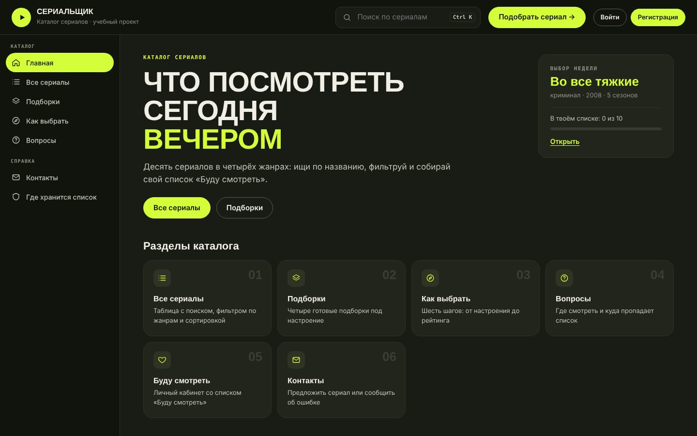

### Все сериалы: карточки из массива, фильтр, поиск
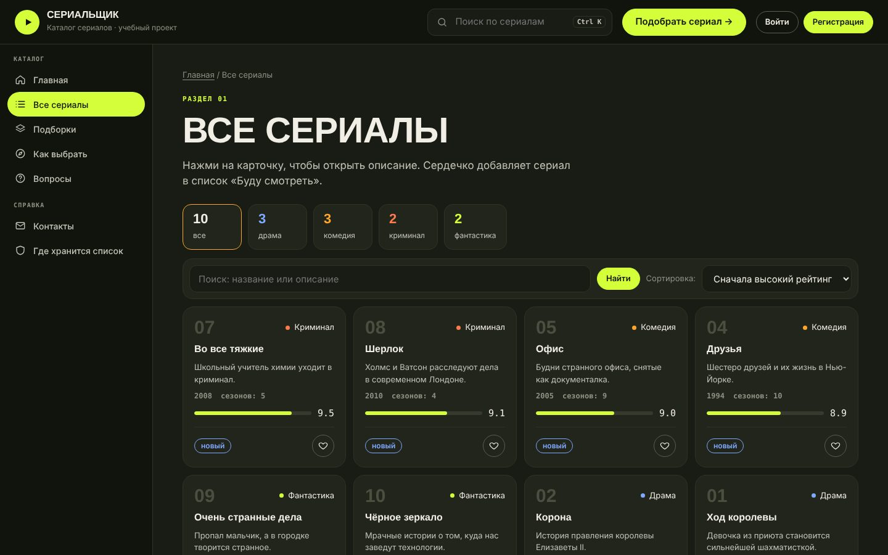

### Страница сериала
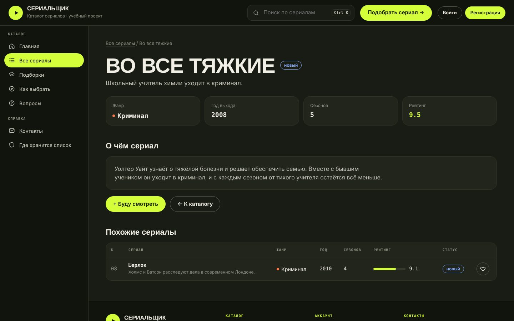

### Подборки со слайдером
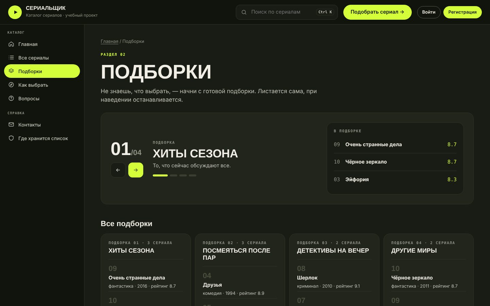

### Как выбрать и Вопросы
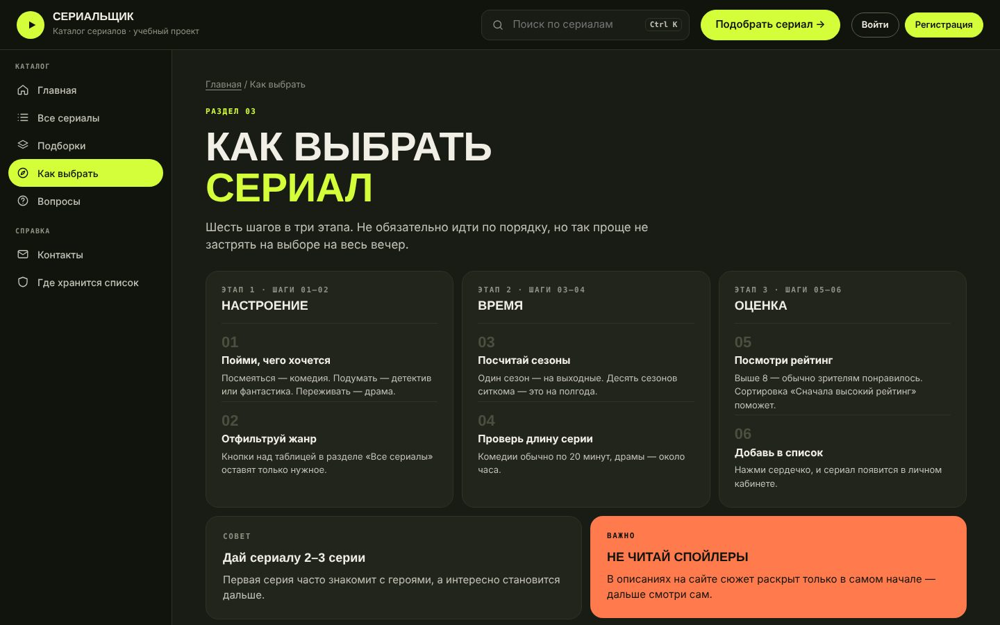
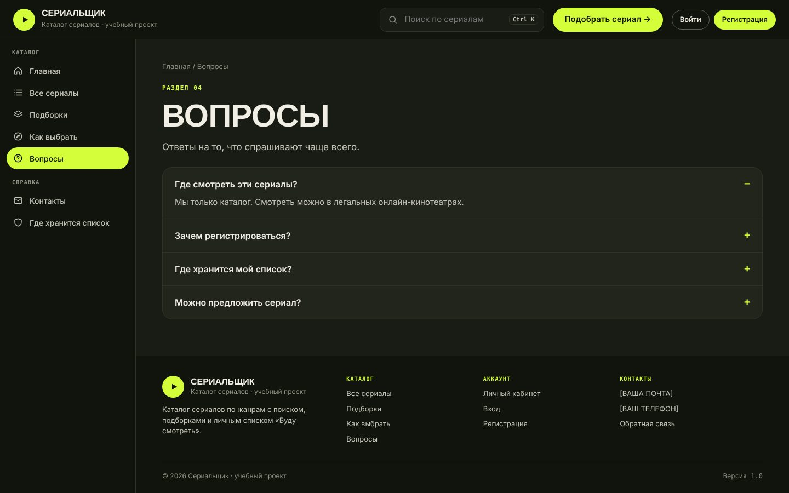

### Контакты
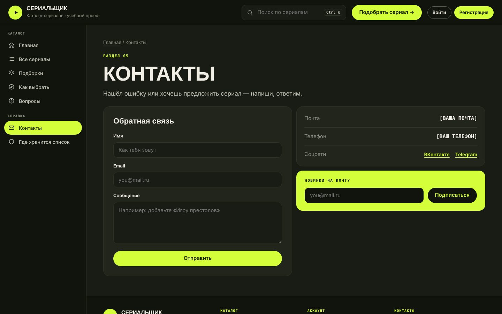

### Вход и регистрация (модальное окно)
| Окно входа | Ошибки при регистрации | Код подтверждения почты |
|---|---|---|
| 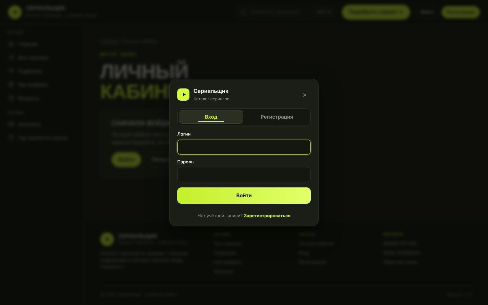 | 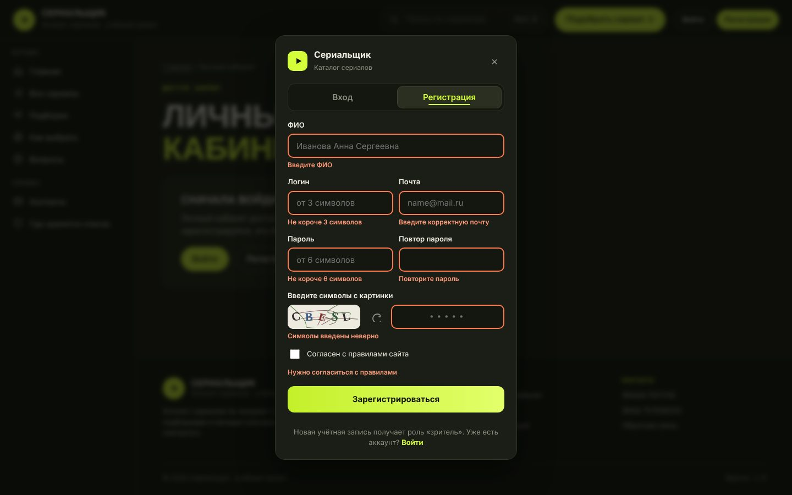 | 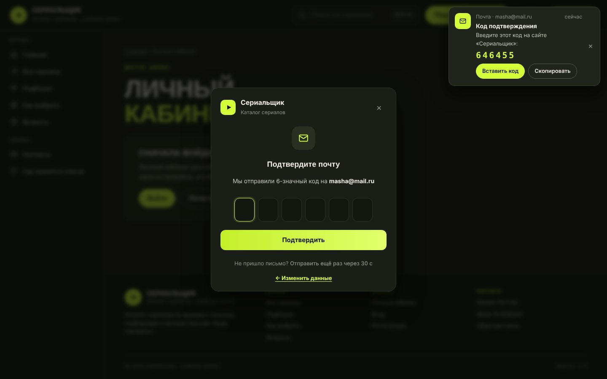 |

### Личный кабинет
| Без входа — доступ закрыт | После входа |
|---|---|
| 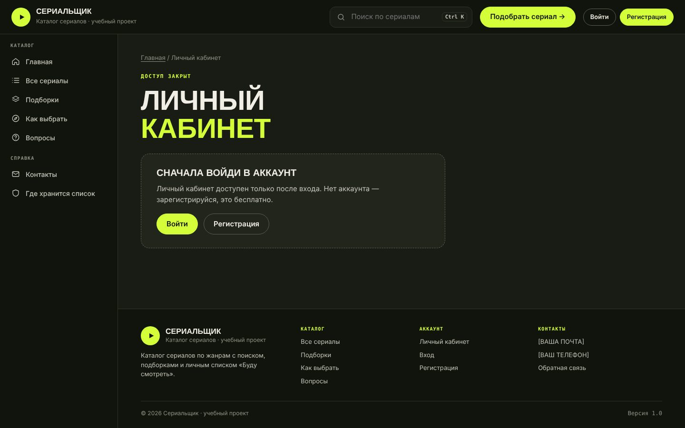 | 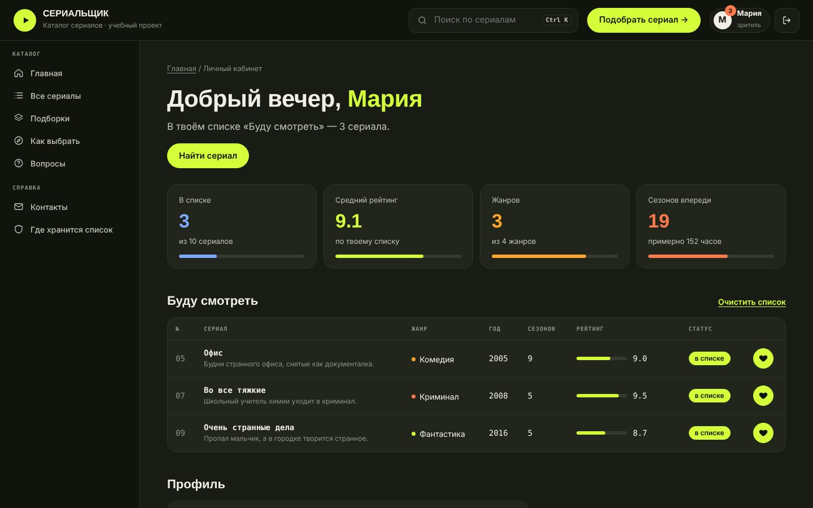 |

### Телефон
| Каталог | Меню (бургер) |
|---|---|
| 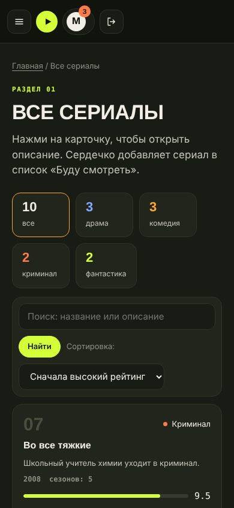 | 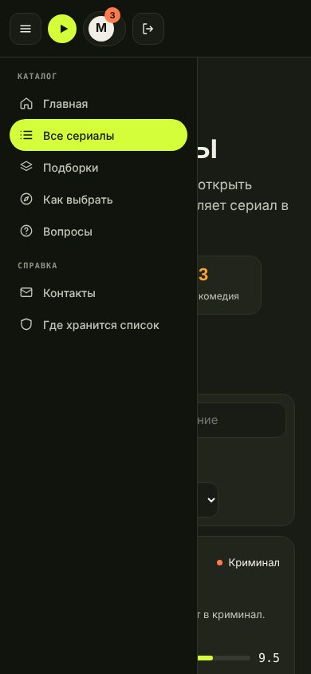 |

## Как запустить

1. Распаковать архив.
2. Открыть `index.html` в браузере.

Шрифты подключаются из Google Fonts. Без интернета сайт работает, но со стандартными шрифтами.

**Тестовый аккаунт:** логин `anya`, пароль `123456`. Можно зарегистрировать и свой.

## Страницы

| Файл | Что на странице |
|------|-----------------|
| `index.html` | Главная: hero-блок «Что посмотреть сегодня вечером», «Выбор недели», 6 карточек разделов |
| `catalog.html` | Все сериалы: 10 карточек из массива `SERIES`, фильтр по жанрам, поиск, сортировка |
| `series.html?id=7` | Страница одного сериала и похожие сериалы того же жанра |
| `collections.html` | Подборки: слайдер из 4 слайдов + все подборки |
| `howto.html` | Как выбрать сериал: 6 шагов в 3 этапа |
| `faq.html` | Вопросы и ответы |
| `contacts.html` | Контакты, форма обратной связи и подписка с проверкой полей |
| `cabinet.html` | Личный кабинет (только после входа): список «Буду смотреть», статистика, профиль |

**Вход и регистрация — не отдельные страницы, а модальное окно** поверх текущей страницы. Оно открывается кнопками «Войти» и «Регистрация» в шапке.

## Функции

### Каталог
- Карточки выводятся из массива `SERIES` (`js/data.js`) функцией `cardHtml()` через `map` + `join`.
- При наведении карточка приподнимается, рамка и номер становятся лаймовыми.
- Фильтр по 4 жанрам, поиск по названию и описанию, сортировка (рейтинг / год / название).
- Поиск из шапки: ввести слово и нажать Enter, откроется каталог с результатами. `Ctrl K` ставит курсор в поиск.
- Клик по карточке открывает страницу сериала.

### Слайдер (`collections.html`)
4 слайда, стрелки, точки, автопрокрутка каждые 5 секунд, пауза при наведении. Написан на JavaScript (функции `go()`, `renderSlider()`, `startAuto()` в `js/main.js`).

### Шапка и меню
- **Шапка (sticky):** логотип, поиск, «Подобрать сериал» и блок аккаунта.
  - Гость видит кнопки «Войти» и «Регистрация».
  - После входа: аватар с именем пользователя и иконка выхода с подсказкой «Выйти». Клик по имени (на телефоне по аватару) открывает личный кабинет. На аватаре счётчик списка «Буду смотреть».
- **Боковое меню:** только разделы сайта: Каталог (Главная, Все сериалы, Подборки, Как выбрать, Вопросы) и Справка (Контакты, Где хранится список). Пунктов аккаунта в нём нет, они в шапке.

### Модальное окно входа и регистрации
- Окно открывается поверх страницы без перехода на другую, фон затемнён и слегка размыт.
- Появляется и закрывается плавно: прозрачность и небольшой сдвиг за 0,2 с.
- Закрывается крестиком, кликом по фону или клавишей Esc.
- Между «Вход» и «Регистрация» переключаются вкладками или ссылками внизу формы, без перезагрузки.
- После входа или регистрации окно закрывается, а шапка, сердечки и кабинет обновляются сразу на текущей странице.

### Регистрация и вход (`js/auth.js`)
- **Регистрация.** Поля: ФИО, логин, почта, пароль, повтор пароля, капча, согласие с правилами. Ошибки показываются под полями:
  - пустое ФИО;
  - логин короче 3 символов, не латиница или уже занят;
  - неверный формат почты или почта уже зарегистрирована;
  - пароль короче 6 символов, пароли не совпадают;
  - неверная капча (картинка при этом обновляется);
  - не отмечено согласие.
- **Подтверждение почты.** Сервера нет, поэтому «письмо» с 6-значным кодом приходит уведомлением справа сверху. Код вводится в 6 клеток, можно вставить через Ctrl+V или кнопкой «Вставить код». Пользователь сохраняется только после верного кода.
- **Вход:** проверка логина и пароля («Пользователь не найден», «Неверный пароль»).
- **Хранение:** `localStorage.users` — все пользователи, `localStorage.currentUser` — кто вошёл. После перезагрузки страницы вход сохраняется.
- **Выход** — иконка в шапке с подсказкой «Выйти». После выхода кабинет закрывается, а список скрывается.

### Личный кабинет
- Без входа показывается «Сначала войди в аккаунт» и кнопки входа и регистрации. Данные кабинета не выводятся.
- После входа: приветствие, 4 карточки статистики, таблица «Буду смотреть», «Очистить список», профиль.
- У каждого пользователя свой список: `localStorage.favs_<логин>`. Без входа сердечко предлагает войти.

### Остальное
- Шапка закреплена (`position: sticky`).
- **Переходы без рывков.** Шапка, меню и подвал лежат прямо в HTML каждой страницы, поэтому при переходе не перерисовываются. Содержимое страницы показывается, когда скрипты его собрали (карточки, кабинет). Сдвиг вёрстки при загрузке (CLS) на всех страницах равен 0. В Chrome, Edge и Safari 18+ при переходе ещё и плавно меняется содержимое, а шапка и меню остаются на месте (`@view-transition`).
- **Полоса прокрутки скрыта** (`scrollbar-width: none` и `::-webkit-scrollbar`). Колесо, тачпад и свайп работают, ширина страницы не меняется.
- Мобильная версия: при ширине ≤ 900px меню прячется за бургер, карточки идут в 4 → 2 → 1 колонку, таблица в кабинете прокручивается вбок.
- У всех полей форм есть `<label>`. Тегов `` нет: иконки сделаны SVG с `aria-hidden`, у капчи (canvas) есть `role="img"` и `aria-label`.
- Анимаций сверх ТЗ нет. Плавно сделаны только эффект при наведении на карточки, выезд бургер-меню, появление модального окна и смена страниц.

## Структура

```
serialshik/
├── index.html, catalog.html, series.html, collections.html, howto.html,
│   faq.html, contacts.html, cabinet.html
├── css/style.css        — все стили, цвета в :root
├── js/data.js           — массив сериалов, подборки, load/save для localStorage
├── js/layout.js         — бургер, поиск в шапке, Ctrl K
├── js/toast.js          — уведомления справа сверху
├── js/auth.js           — модальное окно, регистрация, капча, код подтверждения, вход, выход
├── js/main.js           — каталог, слайдер, страница сериала, кабинет, формы
├── screenshots/         — скриншоты для README
├── README.md
└── .gitignore
```

Шапка, боковое меню, подвал и модальное окно одинаковые и есть в HTML каждой страницы. Так при переходах ничего не перерисовывается. Какая страница открыта, скрипты узнают по `<body data-page="…">`.

## Проверка

Сайт проверен в браузере Chrome на ширине 1440, 390, 360 и 320 px:
- все ссылки меню и подвала;
- слайдер (стрелки, точки, автопрокрутка, пауза);
- 10 карточек и эффект при наведении;
- фильтр, поиск, сортировка;
- регистрация с ошибками, неверный и верный код;
- выход, повторный вход, перезагрузка страницы;
- закрытый кабинет без входа;
- модальное окно: открытие из шапки, переключение вкладок, закрытие крестиком, кликом по фону и Esc;
- выход иконкой; переходы между страницами (сдвиг вёрстки CLS = 0); прокрутка при скрытой полосе;
- бургер-меню.

Ошибок JavaScript в консоли нет.

## Цвета и шрифты

- Фон `#11140D` / `#191C15`, карточки `#22251C`, линии `#2D3424`.
- Акцент: лаймовый `#D4FE3A`. Жанры: драма `#7FA8FF`, комедия `#FFA62B`, криминал `#FF7A4D`, фантастика `#D4FE3A`.
- Шрифты: Unbounded (заголовки), Inter (текст), JetBrains Mono (цифры и подписи).

## Публикация на GitHub Pages

1. Создать репозиторий и загрузить файлы.
2. Settings → Pages → Branch: `main`, папка `/ (root)` → Save.
3. Сайт будет доступен по адресу `https://<логин>.github.io/<репозиторий>/`.

---
© 2026 Сериальщик · учебный проект
